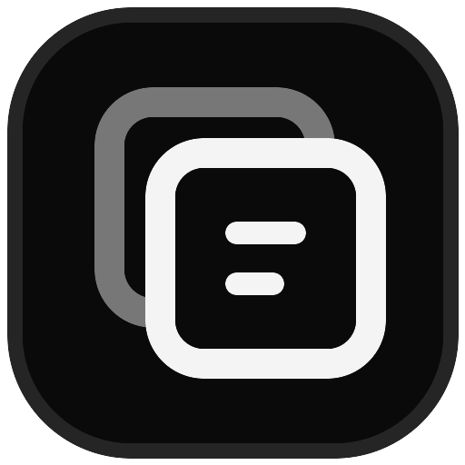

  
  <h1>Style Text</h1>
  
Transforme textos comuns em estilos Unicode copiáveis.

## Sobre

Uma ferramenta simples para converter textos em diferentes variações de caracteres Unicode. O resultado pode ser copiado e usado em biografias, publicações, mensagens e outros sites.

## Recursos

- 22 estilos de texto copiáveis
- Prévia atualizada enquanto você digita
- Preservação de acentos, espaços, símbolos, emojis e quebras de linha
- Cópia com alternativa para navegadores antigos
- Temas claro e escuro com transição circular
- Navegação completa por teclado

## Como usar

1. Baixe ou clone o projeto, ou apenas acesse o site.
2. Abra a pasta do projeto.
3. Execute o arquivo `index.html` no navegador.
4. Digite um texto, escolha um estilo e copie o resultado.

Não é necessário instalar pacotes ou executar comandos.

## Estrutura

- `dist/index.html` — estrutura da interface
- `dist/styles.css` — aparência, responsividade e animações
- `dist/text-engine.js` — mapas e conversões de caracteres
- `dist/script.js` — interação, temas, seletor e área de transferência

## Tecnologias

- HTML
- CSS
- JavaScript puro
